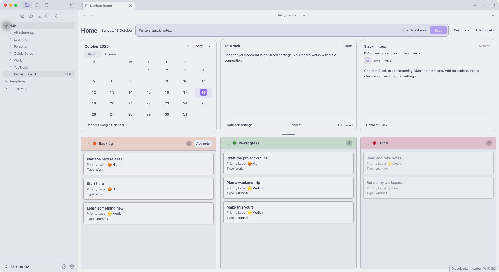

# ES Obsidian Hub



*Demo vault with fictional sample notes. Account connections are optional and start disconnected. The image shows the 1.0.1 layout. Version 1.1.0 adds Mail beside Calendar in the left tile.*

**Write a note, add it to your board, and keep your calendar and work in one place.**

A ready-to-open Obsidian starter vault for Mac. Three kanban columns, a Scratchpad, and Calendar / Mail, YouTrack and Slack widgets come together with the folder sidebar already open. No coding, Codex installation, or paid Obsidian Sync subscription is required.

**[Download the ready-to-use vault](https://github.com/sariekr/es-obsidian-hub/releases/latest/download/es-obsidian-hub.zip)** · **[Connect your accounts](docs/CONNECTIONS.md)** · **[Install with Codex](AGENTS.md)** · **[Troubleshooting](docs/TROUBLESHOOTING.md)**

## First setup

1. [Download Obsidian](https://obsidian.md/download) and move it to Applications. Use **1.11.4 or newer**.
2. Download the vault ZIP above. Double-click it in Finder, then move the entire **es-obsidian-hub** folder somewhere permanent, such as Documents. Keep the whole folder, including the hidden `.obsidian` directory.
3. Open Obsidian. Choose **Open folder as vault → Open**, then select **es-obsidian-hub**. A vault is the folder holding your notes and settings.
4. If you accept running the included plugins, choose **Trust author and enable plugins**. Close the settings window. Both **Kanban Bases View** and **ES Obsidian Hub** should be enabled.
5. **Kanban Board** opens automatically. The left sidebar starts open, with **Files / Search / Bookmarks** tabs at the top and Files selected. The narrow vertical ribbon is hidden. You should see Scratchpad above Calendar / Mail, YouTrack and Slack, then **Backlog → In-Progress → Done**.

The hidden `.obsidian` folder is included in the ZIP. Finder's `Cmd+Shift+.` reveals it. You do not need to find and install the plugins separately. Obsidian's first-run trust decision remains yours. See the official [vault guide](https://help.obsidian.md/manage-vaults) and [community plugin guide](https://help.obsidian.md/community-plugins).

If an "Unknown view type" screen lingers after first trust, ES Hub reopens that board automatically. If it persists, close the board tab and open `Hub → Kanban Board` from Files.

> **Code → Download ZIP** and `git clone` also work. The release ZIP is the simplest option. Keep your everyday vault local. Do not push personal notes to this public repository.

## Try it in two minutes

| What you want to do | Where to click |
| --- | --- |
| Save a quick thought | **Scratchpad → Save** creates a new ordinary Quick Note. Typing or closing a window alone does not create a note. |
| Create a card directly | **Add note** in the Backlog header. A new writing tab opens and the board stays open. |
| Turn an existing note into a card | Open a note → **Add to board** above its title. Its content and location stay intact. |
| Remove a card from the board | **Remove from board** keeps the note. |
| Change status, priority, type or tags | Use **Status / Priority / Type / Tags** above the note, or right-click a card. |
| Wrap a note in its own folder | **Make a folder** creates a containing folder and moves the note into it. |
| Delete a note | The separate **Delete note** action uses Obsidian's confirmation and trash flow. |
| Resize or hide widgets | Drag their shared separator, choose widgets in **Customize**, or use **Hide widgets**. Scratchpad stays visible. |

Open `Hub/Learning/Try Add to board.md` and try **Add to board**. Edit or delete the sample cards. Drag cards between columns. Within a column, priority and date determine their order.

## Make the folders yours

```text
Hub/
├── Kanban Board.base        # Your home screen
├── Work/                    # Replaceable sample category
├── Personal/                # Replaceable sample category
├── Learning/                # Replaceable sample category
├── Quick Notes/             # Scratchpad and Add note destination
├── YouTrack/                # Issues you explicitly choose to import
├── Attachments/             # Attachments
├── _kanban/                 # Shared board schema
└── _priority-seeds/         # Keeps priority choices available
```

`Work`, `Personal` and `Learning` are placeholders. Create a folder such as `Projects` directly under `Hub`. It appears in **Type** automatically. Nested folders are supported. `Attachments` and folders beginning with `.` or `_` are excluded from Type choices.

**Choosing Type moves the note into that Hub folder.** Choosing its current Type keeps nested placement. A folder note carries its containing folder and contents. Renaming a folder does not automatically rewrite existing `category` values. Select the new Type on affected notes if needed.

Keep `Hub`, `Kanban Board.base`, `Quick Notes`, `Attachments`, `_kanban` and `_priority-seeds` for the supplied workflow. To change those paths, use the code map in [AGENTS.md](AGENTS.md). Board membership is a `kanban` tag on notes under Hub.

## Connect your own accounts

| Connection | What you need | Where to start |
| --- | --- | --- |
| Apple Mail | Accounts already configured in Apple Mail on macOS; local Automation permission | **Mail** tab → **Connect Mail** |
| Google Calendar | Your Google account and a Desktop OAuth client; a private iCal address works where available | **Connect Google Calendar** |
| YouTrack | Your server, login, project key, permanent token, **Python 3.11+**, and server `/mcp` support | **YouTrack settings** |
| Slack | A workspace-approved Slack app and your **User OAuth Token** | **Connect Slack**; notes channel and user group are optional |

Follow the **[account connection guide](docs/CONNECTIONS.md)**. The board, note tools, Scratchpad, Calendar, Mail and Slack need no separate Python, Node or npm installation. YouTrack requires Python. Codex, Claude and a separate MCP client are not required. The helper connects directly to your YouTrack server's MCP endpoint.

YouTrack **remote status sync starts off**. If you enable it, moving an imported card changes the remote issue's **State**. Moving out of Done can reopen it. You choose the three State mappings. Startup never bulk-syncs existing cards. **Refresh** reads the list without changing issues.

Mail uses the accounts already enabled in Apple Mail. There is no mail token to create. The Calendar / Mail tile opens on Calendar → Month. Each tab keeps its view and scroll during the session.

## Privacy and updates

This repository contains starter notes and code. It does not contain the maintainer's personal notes, account snapshots, messages, OAuth files or tokens. The preview is from a separate demo vault with sample notes. Your connections start disconnected.

Your writing stays in Markdown files in your own vault. Tokens are stored in local **Obsidian Keychain**. Slack messages, calendar events and Mail metadata stay in memory. Mail reads account labels, sender, subject, received time and read status. It does not read bodies, attachments or passwords. YouTrack caches its list in a local JSON file. Explicitly imported issues and attachments become vault files.

Back up your vault and close Obsidian before updating. Follow the [update guide](docs/UPDATING.md). Do not unpack a new starter ZIP over your entire working vault. Connect accounts separately on each Mac. Scratchpad recovery is device-local, so **Save** before switching devices.

## A prompt for Codex

```text
Read AGENTS.md and README.md in this repository.
Install ES Obsidian Hub as a separate new vault on my Mac.
Do not overwrite my existing notes or Obsidian settings.
Verify the open folder sidebar, board, Add to board and Scratchpad using disposable notes.
Help me connect my accounts using the connection guide and private local input fields.
Do not ask me to paste tokens or OAuth JSON into chat.
```

## Version and contributions

Current starter release: **1.1.0**. Prepared for macOS desktop. Windows, Linux and mobile are outside this release's verification scope. Install this bundled starter vault from the release ZIP. It is unavailable in the community plugin store.

See [verification](docs/VERIFICATION.md), [development workflow](docs/DEVELOPMENT.md), [maintenance instructions](AGENTS.md) and [third-party notices](THIRD-PARTY-NOTICES.md). ES Hub code and starter documentation are MIT licensed. Third-party components keep their own licenses.
